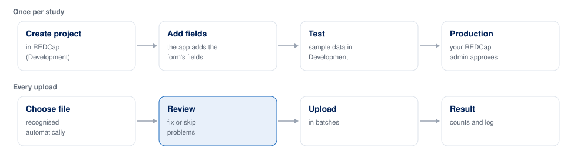

# REDCap Uploader

**Spreadsheet in, REDCap out. No hand-cleaning the table, no hand-writing the data dictionary.**

Getting a spreadsheet into REDCap means two chores that eat days: normalising the table into the strict shape REDCap accepts, and writing the data dictionary that describes it. This app does both. You pick a file, it reads and cleans it, drafts the dictionary, shows you every row, and uploads in batches. Nothing leaves your computer until you click **Upload**.

A desktop app for Windows and macOS, in English and Bahasa Indonesia.


## Chore 1: normalising the table

| By hand | The app |
|---|---|
| Delete the title block, flatten merged headers, trim blank and summary rows | Finds the title block, header rows and data rows itself, counts every row it leaves out, and checks the case count the file states |
| Retype dates as `YYYY-MM-DD`, repair IDs Excel turned into `3.17E+15`, fix decimal commas | Converts text dates and Excel dates, reads `72,5` as 72.5, flags broken IDs, unreadable dates and dates in the future |
| Recode every answer ("Neg", "NEG", "Negatif" to `0`) | Matches spellings to REDCap codes, ignoring case and spacing. An unknown spelling is reported, never guessed, and "unknown" keeps its own code |
| Strip names, addresses and ID numbers | Drops identifier columns and turns IDs into codes made with your team's secret key, so a patient still links across files |
| Invent a record ID and hunt for duplicates | Builds the record IDs and reports blank and duplicate ones |
| Check every value by eye | Checks required fields, allowed answers, number ranges, dates and duplicates, and marks each problem in the table |
| Fix errors in Excel, then start over | Edit a value or skip a row in the app. The table is checked again, and every change is logged |

## Chore 2: creating the data dictionary

| By hand | The app |
|---|---|
| Write one row per field in REDCap's 18-column file: name, type, validation, answers | **Create a data dictionary** drafts it from your spreadsheet: one field per column with a valid name, a type (date, whole number, decimal, text) and answer lists with standard codes (yes/no/unknown, sex, positive/negative) |
| Decide which columns are identifiers | Flags them by their header and by how the values look (16-digit IDs, phone numbers, e-mail, names, long free text), and leaves them out or pseudonymises them. You review every column |
| Upload it and merge it with the fields already there | **Add them to the project** (Development status) merges new fields in, never removes one, saves a backup first, and stops if a field with the same name means something different |
| In Production, send it to the administrator | Saves the dictionary as REDCap's own CSV for them to approve |
| Redo it next month | Keeps it as your own form, and recognises the same layout next time |

Known forms need none of this: the bundled **TBC.03 SO** and **RO** registers (Indonesian TB programme) come with their dictionaries of 67 and 131 fields. A new form is a profile file, not new code.

## Features

- **Reads what people actually have.** .xls, .xlsx and .csv (encoding and delimiter detected), titles above the header, merged header rows, numbered column rows, text dates.
- **Recognises forms.** Known forms are identified from the title block, and a changed layout or renamed column is reported instead of silently misread.
- **Protects identifiers.** Dropped or pseudonymised right after reading, so they never reach REDCap, a log or a screen. The key is created in the app, protected by a passphrase, and compared by fingerprint.
- **Lets you review.** The table that would be sent, with problems marked and filters for errors, warnings, edits and skipped rows.
- **Uploads safely.** Batches of 100. A rejected batch stops the upload and names the row. Uploading again updates records instead of copying them, and an empty cell never erases a value already in REDCap.
- **Checks the project when it connects.** Development or Production, the record ID field, events, repeating instruments, how many records it holds, and what to do about any problem.
- **Keeps a receipt.** Every spreadsheet row mapped to the record it became (or why it was skipped), for spot checks and audits.
- **Works without API access.** Saves the import file and dictionary for REDCap's Data Import Tool instead.
- **Explore.** Counts, missing data, comparisons and trends of the cleaned data, with PNG and CSV export. Descriptive only.
- **Tutorial tab.** Each step with the buttons to press highlighted, and notes on how identifiers are found, what is checked and how records are matched.
- **Demo mode.** A practice REDCap built in, with clean and messy sample files, so you can try everything without an account.

## Limits

Classic projects only: events and repeating instruments are not supported yet. In Production the app cannot change the data dictionary. Explore describes the data and does not analyse it. Process real patient data only on approved computers, after ethics approval and data-governance sign-off.

## Try it in two minutes

The app opens in **Demo mode**.

1. Click **Connect**, then **Next**.
2. Under **Or try a sample**, click **Clean**, or **With mistakes** to see problems reported.
3. Click **Next** through each step.

## Install

Installers are built by GitHub Actions: **Actions → Build installers → Run workflow**, then download `windows-installer` or `macos-dmg` from the run. [docs/INSTALL.md](docs/INSTALL.md) covers both systems in both languages.

## Use it with your REDCap project



You need an API token from the project's API page and your team's pseudonym key. **Create a new key…** on the first step makes one and asks you to save a backup. Everyone uploading for a study uses the same key; its fingerprint (such as `7F3A-91C2`) shows that you hold the same one.

## Status

A working prototype, tested on synthetic data against the built-in practice REDCap and a REDCap 15.6.0 test project. [docs/REDCAP_ASSUMPTIONS.md](docs/REDCAP_ASSUMPTIONS.md) lists what the app assumes about REDCap and whether each assumption held. Progress is in [docs/PROGRESS.md](docs/PROGRESS.md), requirements in [docs/PRD.md](docs/PRD.md), what comes next in [docs/ROADMAP.md](docs/ROADMAP.md).

## For developers

```bash
python -m venv .venv
.venv/Scripts/python -m pip install -r requirements.txt   # macOS: .venv/bin/python
.venv/Scripts/python -m app                               # run the app
```

| Folder | What is in it |
|---|---|
| `core/` | The pipeline: reading, profiles, identifiers, mapping, checks, review, dictionary drafting, the REDCap client, upload. No user-interface code. |
| `app/` | The desktop app (PySide6): wizard, review table, Explore, Tutorial, diagrams |
| `profiles/` | One YAML file per known form |
| `mock_redcap/` | The practice REDCap |
| `synthetic/` | Fake but realistic files, clean and with planted mistakes |
| `i18n/`, `config/` | All on-screen text in both languages; branding and settings |
| `tools/` | Column inventories, dictionary export, and the generators for the tutorial screenshots and diagrams |
| `build/`, `.github/` | Installers and CI |
| `docs/` | Requirements, decisions, REDCap assumptions, install guide, diagrams |

Rules for changing the code (privacy first) are in [CONTRIBUTING.md](CONTRIBUTING.md); the reasons behind design choices are in [docs/DECISIONS.md](docs/DECISIONS.md). After changing a screen, run `python -m tools.make_tutorial` to refresh the tutorial screenshots; after changing a diagram, `python -m tools.make_diagrams`.

## License

MIT. Copyright (c) 2026 Luthfi Izza Pratama (Yayasan RPRI); see [LICENSE](LICENSE). The installers include third-party libraries under their own licences, listed in [THIRD_PARTY_NOTICES.md](THIRD_PARTY_NOTICES.md). Qt and PySide6 are used under the GNU LGPL v3.
