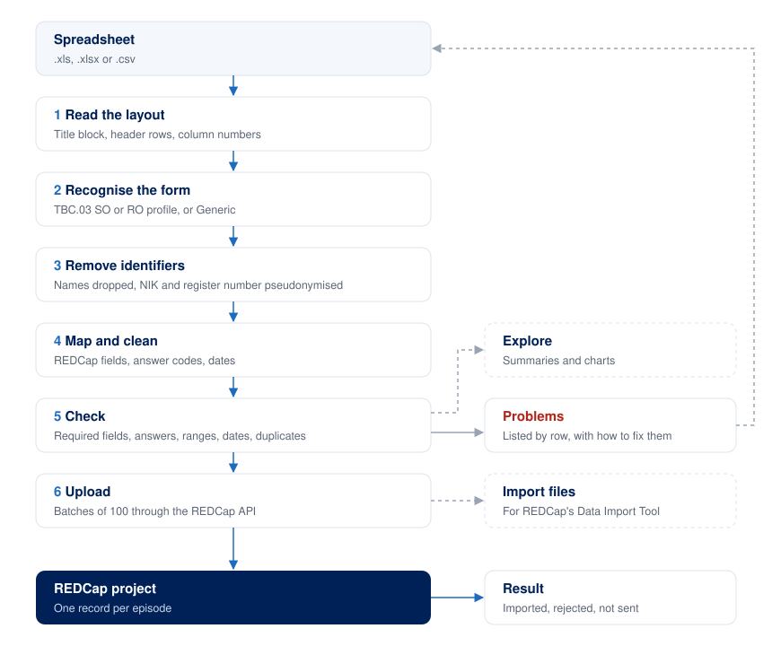

# REDCap Uploader

**Turn a SITB register export, or any spreadsheet, into clean, de-identified records in REDCap, one guided step at a time.**

A desktop app for Windows and macOS, in Bahasa Indonesia and English, built for researchers and TB programme teams who are not programmers.

## The problem it solves

Getting register data into REDCap by hand is slow, and easy to get wrong:
- **Messy files.** SITB exports have a title block, a header spread over several merged rows, and dates written as text.
- **Inconsistent answers.** The same answer is spelled several ways ("Neg", "NEG", "Negatif"). REDCap wants codes (`0`), not words.
- **Patient identifiers.** Names, NIK, addresses and BPJS numbers are in the file and must never reach REDCap or anyone's screen.
- **REDCap is strict.** One bad value can reject a whole upload, often with a message that is hard to read.

REDCap Uploader handles all of this. It explains each step as it goes, and nothing leaves your computer until you click **Upload**.

## How it works



1. **Read the layout.** Finds the title block, the header rows and the official column numbers such as (1) (2) (3). It skips blank and summary rows, and counts each one it skips.
2. **Recognise the form.** A TBC.03 SO or RO export uses that form's **profile**: a settings file that says what each numbered column means. Any other sheet is read in **Generic** mode, where columns are matched by name.
3. **Remove identifiers.** Name, address, BPJS and medical record numbers are dropped. The NIK and the patient register number become **pseudonyms**: codes made with your team's secret key. The same patient always gets the same code, so their episodes stay linked, but the code cannot be turned back into the NIK without the key.
4. **Map and clean.** Columns become REDCap fields, answers become REDCap codes ("L" → 1, "NEG" → 0), and dates become `YYYY-MM-DD`. "Tidak diketahui" keeps its own code, and an unknown spelling is reported, never guessed.
5. **Check (dry run).** Every row is checked against the form's rules: required fields, allowed answers, ranges, dates and duplicate records. Each problem is listed by spreadsheet row, with how to fix it.
6. **Upload.** The app first asks REDCap which records already exist, then sends the records in batches of 100. Uploading the same file again updates records instead of copying them, and an empty cell never erases a value already in REDCap. If your project has no API access, you can save an import file for REDCap's **Data Import Tool** instead.

Along the way:
- **Explore** shows summaries and charts of the cleaned data: counts, averages, missing data, comparisons and trends. It never sends anything to REDCap.
- **What's happening?**, under every step, explains it in plain words and shows the exact requests sent to REDCap, with the token hidden.

## What does it work with?

| File | Status | How it is read |
|---|---|---|
| **SITB TBC.03 SO** (drug-sensitive TB register) | ✅ Ready | Its own profile: all 84 columns understood, with value maps and rules |
| **SITB TBC.03 RO** (drug-resistant TB register) | ✅ Ready | Its own profile: all 114 numbered columns (144 sheet columns) |
| **Other SITB forms** (for example TB.01 or TB.06) | ⏳ Not yet | Each needs its own profile: a settings file, not new code. A sample export of the form is needed to write it. |
| **Any other spreadsheet** with one header row (.csv, .xlsx, .xls) | ⚠️ Basic | Generic mode: columns matched to REDCap fields by name, and look-alike identifier columns (names, NIK, phone, address) dropped. Answers must already be REDCap codes, and dates are sent as written. |

The TBC.03 profiles came from one facility's exports, but nothing is tied to that site. Exports from any facility, district or province work, and spellings the profile does not know yet are reported so they can be added.

## Try it in two minutes (no account needed)

The app opens in **Demo mode**, with a practice REDCap built in. Nothing leaves your computer.

1. Click **Connect**, then **Next**.
2. Under **Or try a sample**, click **Clean**, or click **With mistakes** to see how problems are reported.
3. Click **Next** through each step, then **Explore data** on the last one.

## Install

Installers are built by GitHub Actions: **Actions → Build installers → Run workflow**. Then download `windows-installer` or `macos-dmg` from the finished run. [docs/INSTALL.md](docs/INSTALL.md) walks through installing on Windows and macOS, in both languages.

## Using it with your real REDCap project

You need three things:
- **A REDCap project** with the form's fields. The app saves the matching data dictionary for you, and you upload it once on the project's Data Dictionary page.
- **An API token** from the project's API page. The app keeps it in memory only: never in a file or a log.
- **Your team's pseudonym key**, kept outside the app and backed up. Use the same key for every upload in a study, or patients will not link across files. To make one:

  ```bash
  python -c "import secrets; print(secrets.token_hex(32))"
  ```

Real patient exports should only be processed on approved computers, after your study's ethics approval and data-governance sign-off.

## Status

A working prototype, tested on synthetic data against the built-in practice REDCap. It has not yet been tested against a real REDCap server. Every assumption about real REDCap is listed in [docs/REDCAP_ASSUMPTIONS.md](docs/REDCAP_ASSUMPTIONS.md), and each one is checked once a test project is available. Progress and open questions are in [docs/PROGRESS.md](docs/PROGRESS.md).

## For developers

```bash
python -m venv .venv
.venv/Scripts/python -m pip install -r requirements-dev.txt   # macOS: .venv/bin/python
.venv/Scripts/python -m pytest                               # about 200 tests
.venv/Scripts/python -m app                                  # run the app
```

| Folder | What is in it |
|---|---|
| `core/` | The pipeline: reading files, profiles, identifiers, mapping, checks, the REDCap client, upload, summaries. No user-interface code. |
| `app/` | The desktop wizard, the Explore screen and the explanation panels (PySide6) |
| `profiles/` | One YAML settings file per source form |
| `mock_redcap/` | The built-in practice REDCap |
| `synthetic/` | Generators of fake but realistic register files (clean and with planted mistakes) |
| `i18n/` | All on-screen text, in Indonesian and English |
| `config/` | Branding, REDCap target settings and Explore settings |
| `build/`, `.github/` | Installers and CI |
| `docs/` | PRD, decisions, REDCap assumptions, install guide, structure-only column inventories of the real forms |

Rules for changing the code (privacy first) are in `CONTRIBUTING.md`, and the reasons behind each design choice are in [docs/DECISIONS.md](docs/DECISIONS.md).
