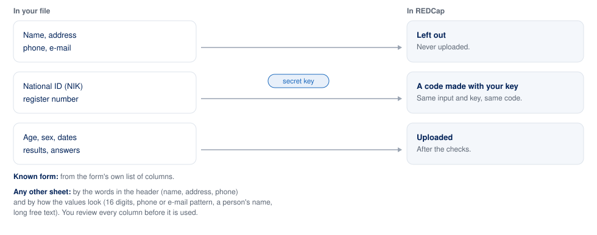

# REDCap Uploader: requirements

Updated 2026-10-21. Where this differs from `CONTRIBUTING.md` (hard rules, record IDs, upload path), `CONTRIBUTING.md` wins.

## Summary

A desktop app that takes a spreadsheet export, cleans and de-identifies it, lets the person review every row, and uploads it to a REDCap project. It is for researchers and programme teams who know their data but not REDCap's import rules. It is not tied to one source system, site, study or country: what is specific to a form lives in a profile file, and any spreadsheet with one header row can be turned into a form.

**Problem.** Data reaches REDCap through exports with title blocks, merged headers, text dates, inconsistent spellings and patient identifiers. Cleaning them by hand is slow and error-prone, and a rejected import in a live project is a bad place to learn what went wrong.

**Product shape.** Native app for Windows and macOS, installed with nothing else to set up. Bahasa Indonesia and English. A built-in practice REDCap (Demo mode) for trying it; Real mode needs only a URL and a token.

## Users

| User | Needs | Typical task |
| --- | --- | --- |
| Researcher or assistant | Few clicks, plain errors, confidence nothing breaks | Upload a monthly export, fix or skip the rows that fail |
| Study data manager | Set up a project and a form once | Add a form's fields, review a drafted data dictionary, share the pseudonym key |
| New team member | See how an upload works without risk | Follow the Tutorial tab in Demo mode |
| Developer | A reusable pipeline and a safe test target | Run the messy sample file, try a REDCap test project |

## Goals and non-goals

**Goals.** Upload a spreadsheet to REDCap without code. Never let identifiers reach REDCap, a log or a screen. Show exactly what will be sent and let the person fix or skip it. Say what is wrong, where, and how to fix it. Work for any form through a profile, and for any other sheet through a drafted data dictionary.

**Non-goals.** Logins, multi-user features, a web version. Repeating instruments and longitudinal events (planned, not built). Merging sources, modelling or inferential statistics: the Explore screen describes the cleaned data and nothing more. Pixel-perfect REDCap behaviour in the practice server.

## How it works

The app is five steps and two tabs: **Upload** (the wizard) and **Tutorial**.

| Step | The person | The app |
| --- | --- | --- |
| 1. Connect | Chooses Demo, or enters URL and token and loads or creates the pseudonym key | Shows the project name and REDCap version and a checklist (Development or Production, record ID field, events, repeating instruments, record count); keeps the token in memory only |
| 2. Choose file | Picks or drops a .csv, .xlsx or .xls | Finds the title block, header rows and data rows; recognises a known form or offers to draft a data dictionary; checks the project has the form's fields and adds the missing ones in Development, or saves the dictionary in Production |
| 3. Review | Looks through the table, edits a value or skips a row | Drops or pseudonymises identifiers, converts answers and dates, checks every row, marks problems in the table, re-checks after each change, records every edit and skipped row. Errors block the upload until fixed or skipped |
| 4. Upload | Clicks Upload | Shows new and existing record counts, then sends batches of 100; a rejected batch stops the upload. Can write import files for REDCap's Data Import Tool instead |
| 5. Result | Reads the outcome | Counts, REDCap's messages with plain fixes, the edits and skipped rows, a log and a receipt to save |

A project is set up once, then used for every upload:

**Review.** The table lists every row that would be sent, one column per field, with the spreadsheet row number. Problem cells are tinted, edited cells and skipped rows are marked. Filters: all, errors, warnings, edited, skipped; go to a row; next problem. A choice field is edited from its list of answers; other fields are typed and refused if unreadable. Fields made from an identifier cannot be edited. Edits apply to this upload only; the source file is never changed.

**Readiness check.** On connecting, a short table says whether the project is in Development (the app can add fields) or Production (it cannot), whether its record ID field is `record_id`, whether it uses events or repeating instruments (not supported yet), and how many records it holds. Each problem says what to do. It blocks nothing: the later steps check what they need, and REDCap import rights can only be checked by uploading.

**Receipt.** After an upload, **Save receipt** writes a CSV with every row of the file: its row number, the record ID it became, what happened (created, updated, rejected, not sent, skipped by you, skipped for errors), the batch, and the names of any fields edited. It holds no identifiers, but beside the source file it can trace a record back to its row, so it is kept with the same care as the file.

**Identifiers.** Known forms list every column with a role: drop, pseudonymise or keep; a column the form does not list is never uploaded. For other sheets the app flags columns by header words (name, address, phone, insurance, medical record, date of birth) and by values (16-digit national IDs, phone numbers, e-mail addresses, names, long free text; at least 80% of filled cells). The person reviews every column before a drafted form is used. National IDs and register numbers become keyed hashes (HMAC-SHA256); the key is created in the app, protected by a passphrase, and compared by fingerprint.

**Checks.** Required fields (and required-when rules), allowed answers, number ranges, unreadable and future dates, duplicate record IDs. Unknown spellings are reported, never guessed; "unknown" keeps its own code. REDCap does not enforce ranges or future dates on import, so these checks are the only gate.

**Forms.** A profile (YAML) holds a form's identity, layout, columns with roles and types, answer maps, rules, REDCap field names and labels in both languages. Bundled: TBC.03 SO and RO (Indonesian TB programme registers) and Generic. A drafted profile from any single-header sheet is saved in the person's own folder and recognised next time.

**Explore.** Descriptive summaries and charts of the cleaned table (overview, variables, distributions, missing data, group comparison, over time), each with PNG or CSV export; groups under 5 records are flagged. It sends nothing.

**Tutorial.** Annotated screenshots of each step with numbered highlights on what to press, and short notes on identifiers, pseudonyms, checks, records and batches, edits, and project setup. Screenshots are made from the app with synthetic data (`tools/make_tutorial.py`); diagrams come from one source (`app/diagrams.py`).

## Non-functional requirements

| Area | Requirement |
| --- | --- |
| Privacy | No patient-identifying data in the repo, screenshots, logs or errors. Raw identifiers exist only between reading and pseudonymising. Real data only on approved machines. No telemetry |
| Token | Memory only; never in a file, log or error |
| Install | Windows installer and macOS .dmg wrapping a PyInstaller build; no Python on the user's machine |
| Speed | Window in under 5 seconds; a 3,600-row file checks in under a second; Explore's first chart in under 3 seconds for 10,000 rows |
| Reliability | A failed batch never leaves doubt about what was imported; every skipped, edited or rejected row is reported |
| Languages | English and Bahasa Indonesia, switchable; all text in `i18n/` |
| Usability | Everything by mouse; no raw stack traces; one highlighted action per step in the tutorial |
| Maintainability | UI-free `core/`; settings in config; assumptions about REDCap written down and checked against a test project (`docs/REDCAP_ASSUMPTIONS.md`) |
| Platforms | Windows 10/11 and macOS on Apple silicon; unsigned until a certificate exists (SmartScreen and Gatekeeper steps are in `docs/INSTALL.md`) |

## Architecture

A thin PySide6 app over a UI-free core. Only `core/client.py` imports PyCap and only it touches the network. Demo mode points that client at a Flask mock on 127.0.0.1; Real mode at your server.

| Layer | Choice |
| --- | --- |
| UI | PySide6 (Qt), matplotlib with the Qt backend (loaded lazily) |
| Core | Python 3.10+: grid and layout readers, profiles (YAML, pydantic), identifiers, mapping, normalise, validate, review, dictionary, upload, explore |
| Files | pandas, openpyxl, xlrd |
| REDCap | PyCap; Flask mock |
| Build | PyInstaller, Inno Setup, a .dmg, GitHub Actions on Windows and macOS runners |

## Risks

| Risk | Mitigation |
| --- | --- |
| The practice server differs from real REDCap | Every assumption is listed and checked against a real test project (done on REDCap 15.6.0, Development status; Production still to check) |
| An export's layout changes between editions | A file's layout is compared with its profile before reading; differences are reported, not guessed |
| Identifier detection misses a column | Known forms list columns; drafted forms are reviewed column by column; free-text fields are an open question |
| Pseudonym key lost or changed | Passphrase-protected key file, backup prompt, fingerprint comparison; a different key gives different record IDs |
| REDCap limits in Development (record cap) and Production (no field changes) | Plain messages; the dictionary is saved for the administrator |
| Edits change research data inside the tool | Every edit is highlighted, listed on Result and written to the log with its row |
| Unsigned installers are blocked | Documented first-run steps; certificates before wider rollout |

## REDCap API access

A token belongs to one user and one project and acts with that user's rights. Import needs API import rights plus create and edit rights on each form; export needs API export rights plus export rights on each form. Some institutions approve tokens by form or start them in a test project. Avoid frequent full exports; a token that strains the server can be revoked. Keep the token out of code, chat and email, and regenerate it if exposed. Ask the administrator about the steps and usual wait, whether API use is allowed for patient data, whether a test project is available, rate limits, and which networks reach the API.

## Open decisions

- One project or two for forms that share field names (SO and RO share 53 names; two differ in meaning).
- Whether free-text fields in the bundled forms should be uploaded, and which location columns to keep.
- Repeating instruments or events for follow-up months.
- Who holds the pseudonym key and where exports live on approved machines.
- Whether any user needs an Intel Mac build.
- Ethics approval and data-governance sign-off before real extracts.
